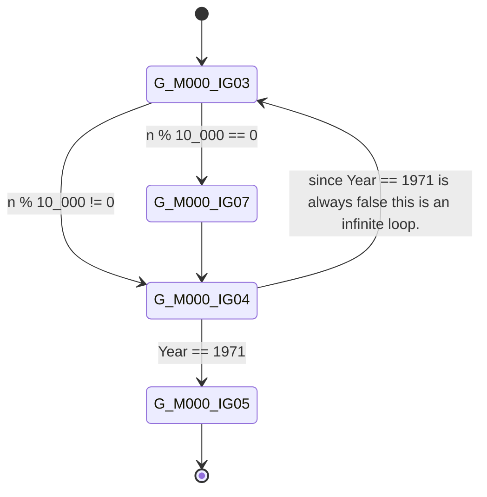
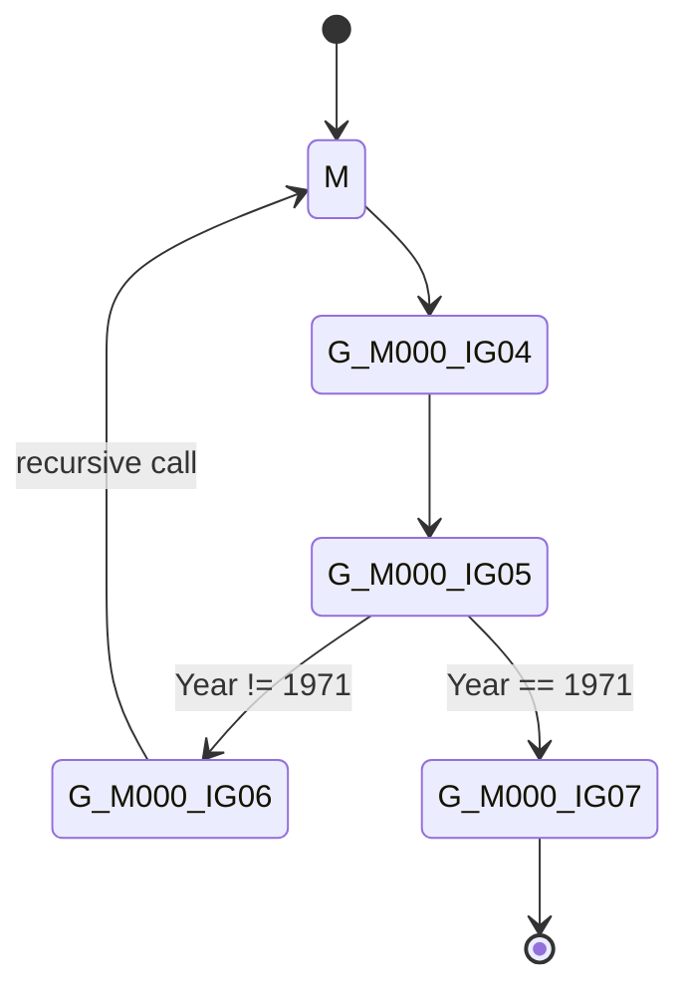

The "this cannot happen" happened
==
Some time ago I was investigating a bug in some C# code when I stumbled across an odd behavior: the bug report claimed that code very similar to the one presented below would cause a hang, and that that was 100% reproducible:

```CSharp
int M(int n)
{
  if (SomeMethod(n))
  {
      // 1. some code that is not relevant.
      return 0;
  }

  // 2. some code that is not relevant.
  return M(n - 1);
}
```
After poking around the code I ended up with 2 hypothesis: i) somehow `SomeMethod()` was never returning or ii) somehow it never returned **true**[^1] in which case the code would simply call itself in an endless recursion; both hypothesis would more or less explain the reported behavior but each had its own problems: `SomeMethod()` was really simple and I was unable to explain how that method would hang so I disregarded that as a possible explanation, leaving only the second hypothesis but in that case the endless recursion should ultimately lead the program to run out of stack space throwing a [StackOverflowException](https://learn.microsoft.com/en-us/dotnet/api/system.stackoverflowexception?view=net-9.0) which, according to the bug report, did not happen.

Trying to reproduce the described behavior by executing the steps from the bug report was the next logical step but to my surprise, instead of a hang the code threw a `StackOverflowException` inside method `M()` indicating that, indeed `SomeMethod()` was never returning `true`. At that point I was really confused: What could be causing the different behavior? Was the stack overflow caused by the same problem or could it be something different? or maybe the bug report was incorrect?

After some head scratching I decided to run the program exactly like the bug reporter; you see, as a developer I usually run the product built locally on my machine instead of installing it from officially released binaries so I installed the product from an official installer and run the reproduction steps. This time, to my surprise (again), the program **froze**.

Now I was even more confused: running the program built locally (from exactly the same git revision as reported in the bug) was causing a `StackOverflowException` whereas running the program installed from an installer would simply hang (as described in the bug). After experimenting with a couple of possibilities I realized that one big difference between the two versions was that the one I built locally was built in *debug mode* while the one included in installers is built in *release mode* so I decided to give it a try by recompiling my local version in *release mode* and running the steps to reproduce the issue; this time, to my surprise (for the third time), the program froze so I finally was able to reproduce the bug.

Next step was to understand: i) why the program was hanging and ii) what was causing the difference in behavior between *debug* and *release* modes. From the user point of view, **i** was more important and whence should be my priority but from a programmer point of view **ii** was way more interesting :). Nevertheless I refrained myself from spending too much time reasoning about **ii** and, instead, debugged the program and realized that indeed there was a bug in **SomeMethod()** preventing it from ever returning **true**.

After implementing a fix (including a unit test, of course ;)) and verifying it was effective I closed the bug but I was not 100% happy with the outcome: given that the root cause of the problem was `SomeMethod()` never returning `true` I would expect to always get a stack overflow, however that only happened in **debug mode**. So I spent some time (more than I would like to admit) investigating it further.

Down the Rabbit Hole
==

Since I knew that **release**/**debug** mode was a key factor and that the program was running in .NET 8.0 I decided to compare the disassembled[^2] version of a slightly different version of that code in both modes by running the program below twice:

```CSharp #:26
using System.Text;

var o = new Test();
Console.WriteLine(o.M(1));

class Test
{
    private static readonly CompositeFormat _format = CompositeFormat.Parse("Sleeping for {0}ms");
    private static int Year = System.DateTime.Now.Year;

    internal int M(int n)
    {
        if (n % 10000 == 0)
        {
            // https://github.com/dotnet/BenchmarkDotNet/issues/1993#issuecomment-1117419356 
            // The comment above says that 100ms of no new methods called is enough to trigger counting
            // number of times M() is called and after 30 calls it should be promoted to tier 1
            // however, in my machine this value is sensitive to as how many times we sleep.
            // Sleeping for 100ms every 10_000 iterations is enough on my linux machine, but
            // on a Windows one (with slightly different .NET runtime versions) 150ms was the
            // minimum.
            const ushort SleepTime = 150;
            Console.WriteLine(string.Format(null, _format, SleepTime));
            Thread.Sleep(SleepTime);
        }

        // Simulates an always false check that is harder for the compiler / JIT to detect and
        // deem that as "dead code"  and eliminate the *if*
        if (Year == 1971)
            return 0;
            
        return M(n - 1);
    } 
}
```

in a Linux environment with:

```bash
DOTNET_JitDisasm=M dotnet run -c Release
DOTNET_JitDisasm=M dotnet run -c Debug
```
and on Windows as:

```powershell
pwsh -Command { $env:DOTNET_JitDisasm="M"; dotnet run -c Release }
pwsh -Command { $env:DOTNET_JitDisasm="M"; dotnet run -c Debug }
```

Setting `DOTNET_JitDisasm`[^3] environment variable to `M` instructs the [*JIT*](https://learn.microsoft.com/en-us/dotnet/standard/managed-execution-process#compilation-by-the-jit-compiler) to print the generated assembly code to the console so I could compare the two versions.

Release mode disassembled code
---
Below you can see the disassembled version when run in **release mode**.
```nasm #:20-22
; Assembly listing for method Test:M(int):int:this (Tier1)
; Emitting BLENDED_CODE for X64 with AVX - Unix
; Tier1 code
; optimized code
; optimized using Dynamic PGO
; rbp based frame
; fully interruptible
; with Dynamic PGO: edge weights are invalid, and fgCalledCount is 786

G_M000_IG01:                ;; offset=0x0000
       push     rbp
       push     r15
       push     rbx
       lea      rbp, [rsp+0x10]
       mov      ebx, esi
 
G_M000_IG02:                ;; offset=0x000B
       mov      r15, 0x75F438CAD50C
 
G_M000_IG03:                ;; offset=0x0015
       mov      edx, 0x68DB8BAD
       mov      eax, edx
       imul     edx:eax, ebx
       mov      esi, edx
       shr      esi, 31
       sar      edx, 12
       add      esi, edx
       imul     esi, esi, 0x2710
       mov      edi, ebx
       sub      edi, esi
       je       SHORT G_M000_IG07
 
G_M000_IG04:                ;; offset=0x0034
       cmp      dword ptr [r15], 0x7B3
       je       SHORT G_M000_IG05
       dec      ebx
       jmp      SHORT G_M000_IG03
 
G_M000_IG05:                ;; offset=0x0041
       xor      eax, eax
 
G_M000_IG06:                ;; offset=0x0043
       pop      rbx
       pop      r15
       pop      rbp
       ret      
 
G_M000_IG07:                ;; offset=0x0048
       mov      rsi, 0x75B418001CC8
       mov      rsi, gword ptr [rsi]
       xor      rdi, rdi
       mov      edx, 150
       call     [System.String:Format[ushort](System.IFormatProvider,System.Text.CompositeFormat,ushort):System.String]
       mov      rdi, rax
       call     [System.Console:WriteLine(System.String)]
       mov      edi, 150
       call     [System.Threading.Thread:Sleep(int)]
       jmp      SHORT G_M000_IG04
 
; Total bytes of code 120
```
Note that based on the following comment added by the JIT we can conclude that the code has been optimized:
```text
; Tier1 code
; optimized code
; optimized using Dynamic PGO
```

If we draw a graph in which the **nodes** are the various **labels** (`G_M000_IG03`, `G_M000_IG04`, etc) and the **vertices** are the possible targets from a given **node** we will end up with something like:


<script type="module">
   import mermaid from 'https://cdn.jsdelivr.net/npm/mermaid@11/dist/mermaid.esm.min.mjs';
</script>

and we can easily see that:

1. There's no signs of a recursion
1. Instead, it seems that the recursion has been replaced by a loop (labels `G_M000_IG03` and `G_M000_IG04`)[^4]
1. The only return point from the method is `G_M000_IG05`, which the code never reaches since `Year == 1971` is always **false**

**Debug mode** disassembled code
---
As my next step I collected the assembly for the same method, but this time in **debug mode**:

```nasm #:81
; Assembly listing for method Test:M(int):int:this (MinOpts)
; Emitting BLENDED_CODE for X64 with AVX - Unix
; MinOpts code
; debuggable code
; rbp based frame
; fully interruptible
; No PGO data

G_M000_IG01:                ;; offset=0x0000
       push     rbp
       sub      rsp, 48
       lea      rbp, [rsp+0x30]
       vxorps   xmm8, xmm8, xmm8
       vmovdqa  xmmword ptr [rbp-0x30], xmm8
       vmovdqa  xmmword ptr [rbp-0x20], xmm8
       xor      eax, eax
       mov      dword ptr [rbp-0x10], eax
       mov      gword ptr [rbp-0x08], rdi
       mov      dword ptr [rbp-0x0C], esi
 
G_M000_IG02:                ;; offset=0x0025
       cmp      dword ptr [(reloc 0x76b8fe8bd330)], 0
       je       SHORT G_M000_IG04
 
G_M000_IG03:                ;; offset=0x002E
       call     CORINFO_HELP_DBG_IS_JUST_MY_CODE
 
G_M000_IG04:                ;; offset=0x0033
       nop      
       mov      eax, dword ptr [rbp-0x0C]
       mov      edi, 0x2710
       cdq      
       idiv     edx:eax, edi
       imul     edi, eax, 0x2710
       mov      esi, dword ptr [rbp-0x0C]
       sub      esi, edi
       xor      edi, edi
       test     esi, esi
       sete     dil
       mov      dword ptr [rbp-0x10], edi
       cmp      dword ptr [rbp-0x10], 0
       je       SHORT G_M000_IG05
       nop      
       mov      rdi, 0x76B8FE8BD4E0
       mov      esi, 2
       call     CORINFO_HELP_GETSHARED_NONGCSTATIC_BASE
       mov      rsi, 0x7678E0001CC8
       mov      rsi, gword ptr [rsi]
       mov      gword ptr [rbp-0x30], rsi
       mov      rsi, gword ptr [rbp-0x30]
       xor      rdi, rdi
       mov      edx, 150
       call     [System.String:Format[ushort](System.IFormatProvider,System.Text.CompositeFormat,ushort):System.String]
       mov      gword ptr [rbp-0x28], rax
       mov      rdi, gword ptr [rbp-0x28]
       call     [System.Console:WriteLine(System.String)]
       nop      
       mov      edi, 150
       call     [System.Threading.Thread:Sleep(int)]
       nop      
       nop      
 
G_M000_IG05:                ;; offset=0x00AE
       mov      rdi, 0x76B8FE8BD4E0
       mov      esi, 2
       call     CORINFO_HELP_GETSHARED_NONGCSTATIC_BASE
       xor      esi, esi
       cmp      dword ptr [(reloc 0x76b8fe8bd514)], 0x7B3
       sete     sil
       mov      dword ptr [rbp-0x14], esi
       cmp      dword ptr [rbp-0x14], 0
       je       SHORT G_M000_IG06
       xor      esi, esi
       mov      dword ptr [rbp-0x18], esi
       nop      
       jmp      SHORT G_M000_IG07
 
G_M000_IG06:                ;; offset=0x00E3
       mov      esi, dword ptr [rbp-0x0C]
       dec      esi
       mov      rdi, gword ptr [rbp-0x08]
       call     [Test:M(int):int:this]
       mov      dword ptr [rbp-0x1C], eax
       mov      eax, dword ptr [rbp-0x1C]
       mov      dword ptr [rbp-0x18], eax
       nop      
 
G_M000_IG07:                ;; offset=0x00FC
       mov      eax, dword ptr [rbp-0x18]
 
G_M000_IG08:                ;; offset=0x00FF
       add      rsp, 48
       pop      rbp
       ret      
 
; Total bytes of code 261
```

Noteworthily points:

1. The assembled code is longer when compared to the one generated for the **release mode** (261 versus 120 bytes)
2. I won't bother trying to understand, let alone explaining, it.
3. Identically to the code in `release mode` the only _return point_ from the method is never executed due to the expression `Year == 1971` never being `true`
4. At line #82 one can see `M()` being called recursively (`call [Test:M(int):int:this]`)
5. The JIT comment about code optimization is not present whence I assumed the code has not been optimized (which makes sense since we are running in debug mode)

Lets draw a similar graph:



Now it is pretty clear that in **debug mode** the `recursive call` has been preserved in the assembly code which explains the `StackOverflowException`.

Summary
==

In the end, the behavior in *both* (**debug** and **release**) *modes* were plausible and the difference was the result of the compiler (in this case the JIT) optimizing the code (a tail call optimization[^4], to be more precise) in **release mode** while running it **as is** in **debug mode**.

As always, all feedback is welcome.

Have fun!


[^1]: Or at least it was returning `false` enough times to lead to a deep recursion

[^2]: Before jumping into assembly code (which I know very little) I first checked the `IL` instructions for both modes but I could not spot anything that would explain the difference in behavior (the `IL` for both modes were essentially identical).

[^3]: The are more [environment variables](https://github.com/dotnet/runtime/blob/main/docs/design/coreclr/jit/viewing-jit-dumps.md) that can be set to control JIT disassembling output.

[^4]: This is known as [tail call optimization](https://en.wikipedia.org/wiki/Tail_call).