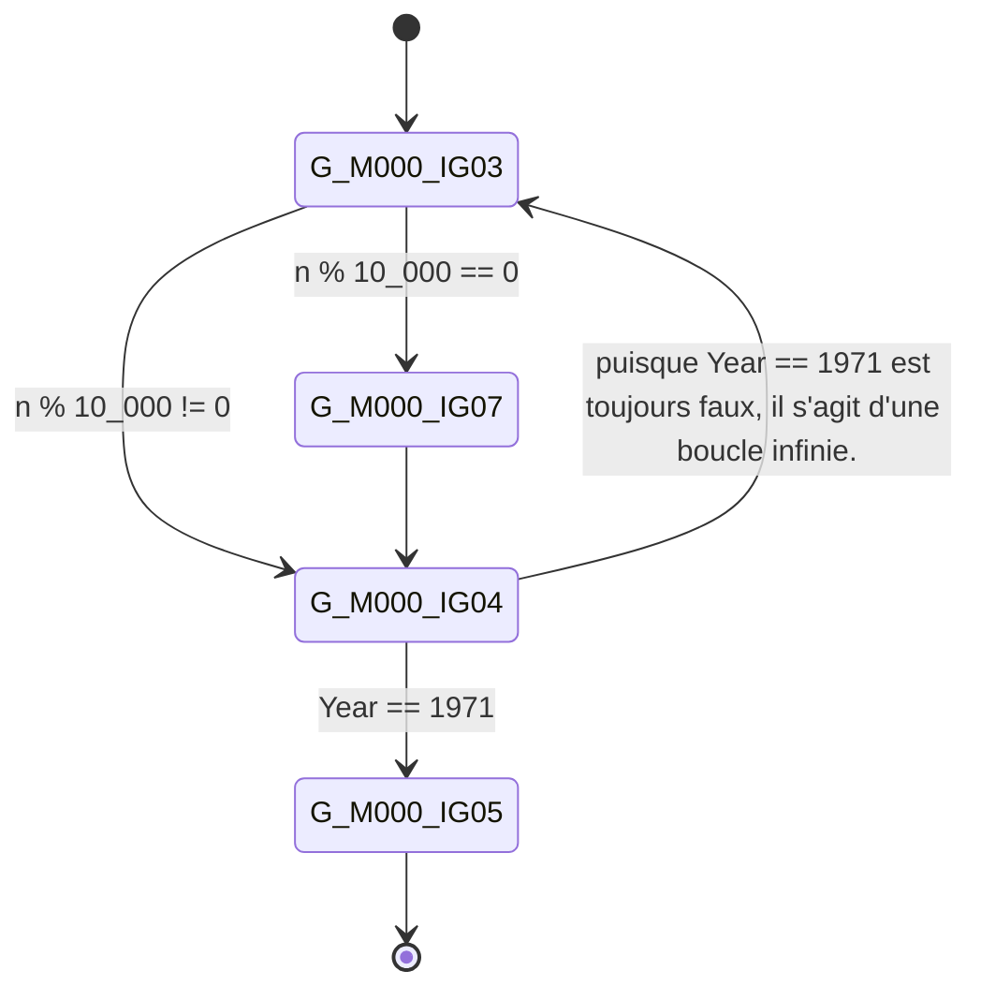
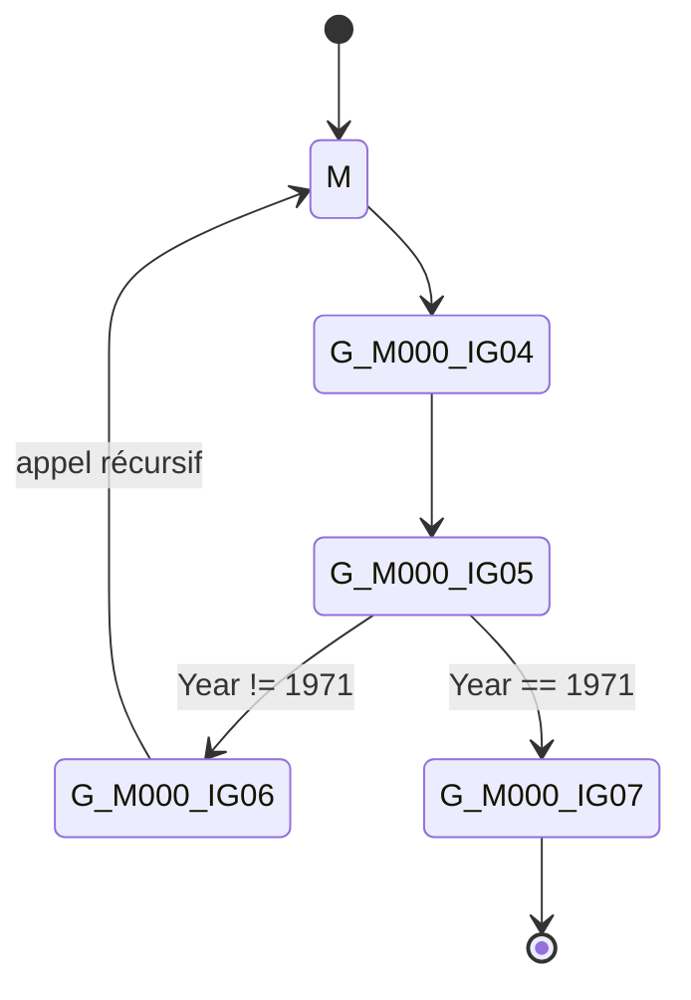

### Le "cela ne peut pas arriver" est arrivé  

Il y a quelque temps, j’enquêtais sur un bug dans du code C# lorsque je suis tombé sur un comportement étrange. Le rapport de bug indiquait qu’un code très similaire à celui-ci provoquait un blocage, et que cela était **100 % reproductible** :  

```CSharp
int M(int n)
{
  if (SomeMethod(n))
  {
      // 1. du code non pertinent.
      return 0;
  }

  // 2. du code non pertinent.
  return M(n - 1);
}
```
En examinant le code, deux hypothèses me sont venues à l’esprit :  
1. **SomeMethod()** ne retournait jamais de valeur.  
2. **SomeMethod()** ne retournait jamais **true**[^1], entraînant une récursion infinie.  

Les deux explications tenaient la route, mais chacune posait problème. **SomeMethod()** était une méthode très simple, et je ne voyais pas comment elle aurait pu provoquer un blocage. J’ai donc écarté cette hypothèse, ne gardant que la seconde. Mais dans ce cas, la récursion infinie aurait dû provoquer une **StackOverflowException**[^2]… Or, d’après le rapport de bug, ce n’était pas le cas.  

### Un premier test… et une surprise  

La prochaine étape logique était d’essayer de reproduire le problème. Mais en suivant les étapes décrites, au lieu d’un blocage, j’ai obtenu une **StackOverflowException** à l’intérieur de la méthode `M()`. Cela confirmait que **SomeMethod()** ne retournait jamais `true`.  

À ce stade, j’étais perplexe :  
- Pourquoi mon test donnait-il un résultat différent du bug rapporté ?  
- Était-ce bien le même problème ?  
- Ou le rapport de bug était-il erroné ?  

Pour en avoir le cœur net, j’ai décidé d’exécuter le programme **exactement** comme l’auteur du rapport. En tant que développeur, je lance généralement l’application en la compilant localement plutôt qu’en l’installant via un package officiel. Cette fois, j’ai installé la version officielle, puis répété les étapes de reproduction.  

Et là, **le programme s’est figé**.  

### Debug vs Release : une différence troublante  

J’étais encore plus confus. Avec mon build **local** (issu de la même révision Git que celle mentionnée dans le bug), j’obtenais une **StackOverflowException**. Mais avec la version installée, le programme **se bloquait**, exactement comme indiqué dans le rapport.  

En cherchant une explication, j’ai réalisé une différence clé entre les deux versions :  
- Mon build local était en **mode debug**.  
- La version officielle était en **mode release**.  

Par curiosité, j’ai recompilé mon code en **mode release** et relancé le test. **Le programme s’est figé.** J’avais enfin reproduit le bug !  

### Pourquoi le programme se bloque-t-il ?  

Deux questions restaient en suspens :  
1. Pourquoi le programme se bloquait-il au lieu de planter avec un dépassement de pile ?  
2. Qu’est-ce qui causait la différence de comportement entre **debug** et **release** ?  

D’un point de vue utilisateur, la première question était la plus critique. Mais en tant que développeur, la seconde était bien plus intrigante 😏. Malgré tout, je me suis concentré sur la correction du bug : en déboguant le programme, j’ai confirmé qu’un problème dans **SomeMethod()** l’empêchait de retourner **true**.  

Après avoir implémenté un correctif (et un test unitaire, bien sûr ! 😉), le bug était résolu. Mais quelque chose continuait à me titiller…  

### Pourquoi une StackOverflowException en mode Debug, mais pas en Release ?  

Je savais désormais que le mode **debug/release** influençait directement le comportement du programme. Comme le programme tournait sous **.NET 8.0**, j’ai décidé de comparer le **code désassemblé**[^3] en exécutant le programme ci-dessous dans les deux modes :  

```CSharp
using System.Text;

var o = new Test();
Console.WriteLine(o.M(1));

class Test
{
    private static readonly CompositeFormat _format = CompositeFormat.Parse("Pause de {0}ms");
    private static int Year = System.DateTime.Now.Year;

    internal int M(int n)
    {
        if (n % 10000 == 0)
        {
            // https://github.com/dotnet/BenchmarkDotNet/issues/1993#issuecomment-1117419356 
            // Selon ce commentaire, 100 ms sans appel de nouvelles méthodes suffisent 
            // pour que le JIT commence à optimiser M(). Après 30 appels, il devrait être 
            // promu au Tier 1. Mais sur ma machine, cette valeur varie en fonction de 
            // la fréquence des pauses.
            // - Sur Linux, 100 ms toutes les 10 000 itérations suffisent.  
            // - Sur Windows (avec une version légèrement différente du runtime .NET),  
            //   **150 ms** étaient nécessaires.
            const ushort SleepTime = 150;
            Console.WriteLine(string.Format(null, _format, SleepTime));
            Thread.Sleep(SleepTime);
        }

        // Simule une condition toujours fausse difficile à détecter par le compilateur/JIT, 
        // empêchant l’optimisation du `if` en "code mort".
        if (Year == 1971)
            return 0;
            
        return M(n - 1);
    } 
}
```

Dans un environnement Linux avec :

```bash
DOTNET_JitDisasm=M dotnet run -c Release
DOTNET_JitDisasm=M dotnet run -c Debug
```

Et sous Windows comme :

```powershell
pwsh -Command { $env:DOTNET_JitDisasm="M"; dotnet run -c Release }
pwsh -Command { $env:DOTNET_JitDisasm="M"; dotnet run -c Debug }
```

Définir la variable d'environnement `DOTNET_JitDisasm`[^3] à `M` demande au [*JIT*](https://learn.microsoft.com/en-us/dotnet/standard/managed-execution-process#compilation-by-the-jit-compiler) d'afficher le code assembleur généré dans la console afin que je puisse comparer les deux versions.  

Code désassemblé en mode Release  
---  
Ci-dessous, vous pouvez voir la version désassemblée lorsqu'elle est exécutée en **mode release**.
```nasm #:20-22
; Assembly listing for method Test:M(int):int:this (Tier1)
; Emitting BLENDED_CODE for X64 with AVX - Unix
; Tier1 code
; optimized code
; optimized using Dynamic PGO
; rbp based frame
; fully interruptible
; with Dynamic PGO: edge weights are invalid, and fgCalledCount is 786

G_M000_IG01:                ;; offset=0x0000
       push     rbp
       push     r15
       push     rbx
       lea      rbp, [rsp+0x10]
       mov      ebx, esi
 
G_M000_IG02:                ;; offset=0x000B
       mov      r15, 0x75F438CAD50C
 
G_M000_IG03:                ;; offset=0x0015
       mov      edx, 0x68DB8BAD
       mov      eax, edx
       imul     edx:eax, ebx
       mov      esi, edx
       shr      esi, 31
       sar      edx, 12
       add      esi, edx
       imul     esi, esi, 0x2710
       mov      edi, ebx
       sub      edi, esi
       je       SHORT G_M000_IG07
 
G_M000_IG04:                ;; offset=0x0034
       cmp      dword ptr [r15], 0x7B3
       je       SHORT G_M000_IG05
       dec      ebx
       jmp      SHORT G_M000_IG03
 
G_M000_IG05:                ;; offset=0x0041
       xor      eax, eax
 
G_M000_IG06:                ;; offset=0x0043
       pop      rbx
       pop      r15
       pop      rbp
       ret      
 
G_M000_IG07:                ;; offset=0x0048
       mov      rsi, 0x75B418001CC8
       mov      rsi, gword ptr [rsi]
       xor      rdi, rdi
       mov      edx, 150
       call     [System.String:Format[ushort](System.IFormatProvider,System.Text.CompositeFormat,ushort):System.String]
       mov      rdi, rax
       call     [System.Console:WriteLine(System.String)]
       mov      edi, 150
       call     [System.Threading.Thread:Sleep(int)]
       jmp      SHORT G_M000_IG04
 
; Total bytes of code 120
```
Notez que, sur la base du commentaire suivant ajouté par le JIT, nous pouvons conclure que le code a été optimisé :
```text
; Tier1 code
; optimized code
; optimized using Dynamic PGO
```
Si nous dessinons un graphe dans lequel les **nœuds** sont les différents **labels** (`G_M000_IG03`, `G_M000_IG04`, etc.) et les **arêtes** représentent les cibles possibles à partir d'un **nœud** donné, nous obtiendrons quelque chose comme ceci :  


<script type="module">
   import mermaid from 'https://cdn.jsdelivr.net/npm/mermaid@11/dist/mermaid.esm.min.mjs';
</script>

Nous pouvons ainsi facilement observer que :  

1. Il n'y a aucun signe de récursion.  
2. À la place, il semble que la récursion ait été remplacée par une boucle (labels `G_M000_IG03` et `G_M000_IG04`).[^4]  
3. Le seul point de retour du programme est `G_M000_IG05`, mais ce code n'est jamais atteint puisque `Year == 1971` est toujours **faux**.  

**Code désassemblé en mode Debug**  
---  
Ci-dessous, vous pouvez voir la version désassemblée lorsqu'elle est exécutée en **mode debug**.

```nasm #:81
; Assembly listing for method Test:M(int):int:this (MinOpts)
; Emitting BLENDED_CODE for X64 with AVX - Unix
; MinOpts code
; debuggable code
; rbp based frame
; fully interruptible
; No PGO data

G_M000_IG01:                ;; offset=0x0000
       push     rbp
       sub      rsp, 48
       lea      rbp, [rsp+0x30]
       vxorps   xmm8, xmm8, xmm8
       vmovdqa  xmmword ptr [rbp-0x30], xmm8
       vmovdqa  xmmword ptr [rbp-0x20], xmm8
       xor      eax, eax
       mov      dword ptr [rbp-0x10], eax
       mov      gword ptr [rbp-0x08], rdi
       mov      dword ptr [rbp-0x0C], esi
 
G_M000_IG02:                ;; offset=0x0025
       cmp      dword ptr [(reloc 0x76b8fe8bd330)], 0
       je       SHORT G_M000_IG04
 
G_M000_IG03:                ;; offset=0x002E
       call     CORINFO_HELP_DBG_IS_JUST_MY_CODE
 
G_M000_IG04:                ;; offset=0x0033
       nop      
       mov      eax, dword ptr [rbp-0x0C]
       mov      edi, 0x2710
       cdq      
       idiv     edx:eax, edi
       imul     edi, eax, 0x2710
       mov      esi, dword ptr [rbp-0x0C]
       sub      esi, edi
       xor      edi, edi
       test     esi, esi
       sete     dil
       mov      dword ptr [rbp-0x10], edi
       cmp      dword ptr [rbp-0x10], 0
       je       SHORT G_M000_IG05
       nop      
       mov      rdi, 0x76B8FE8BD4E0
       mov      esi, 2
       call     CORINFO_HELP_GETSHARED_NONGCSTATIC_BASE
       mov      rsi, 0x7678E0001CC8
       mov      rsi, gword ptr [rsi]
       mov      gword ptr [rbp-0x30], rsi
       mov      rsi, gword ptr [rbp-0x30]
       xor      rdi, rdi
       mov      edx, 150
       call     [System.String:Format[ushort](System.IFormatProvider,System.Text.CompositeFormat,ushort):System.String]
       mov      gword ptr [rbp-0x28], rax
       mov      rdi, gword ptr [rbp-0x28]
       call     [System.Console:WriteLine(System.String)]
       nop      
       mov      edi, 150
       call     [System.Threading.Thread:Sleep(int)]
       nop      
       nop      
 
G_M000_IG05:                ;; offset=0x00AE
       mov      rdi, 0x76B8FE8BD4E0
       mov      esi, 2
       call     CORINFO_HELP_GETSHARED_NONGCSTATIC_BASE
       xor      esi, esi
       cmp      dword ptr [(reloc 0x76b8fe8bd514)], 0x7B3
       sete     sil
       mov      dword ptr [rbp-0x14], esi
       cmp      dword ptr [rbp-0x14], 0
       je       SHORT G_M000_IG06
       xor      esi, esi
       mov      dword ptr [rbp-0x18], esi
       nop      
       jmp      SHORT G_M000_IG07
 
G_M000_IG06:                ;; offset=0x00E3
       mov      esi, dword ptr [rbp-0x0C]
       dec      esi
       mov      rdi, gword ptr [rbp-0x08]
       call     [Test:M(int):int:this]
       mov      dword ptr [rbp-0x1C], eax
       mov      eax, dword ptr [rbp-0x1C]
       mov      dword ptr [rbp-0x18], eax
       nop      
 
G_M000_IG07:                ;; offset=0x00FC
       mov      eax, dword ptr [rbp-0x18]
 
G_M000_IG08:                ;; offset=0x00FF
       add      rsp, 48
       pop      rbp
       ret      
 
; Total bytes of code 261
```
Points remarquables :  

1. Le code assembleur est plus long que celui généré en **mode release** (261 contre 120 octets).  
2. Je ne vais pas essayer de le comprendre, encore moins de l'expliquer.  
3. Comme pour le code en **mode release**, le seul _point de retour_ de la méthode n'est jamais exécuté puisque l'expression `Year == 1971` n'est jamais `true`.  
4. À la ligne #82, on peut voir que `M()` est appelé récursivement (`call [Test:M(int):int:this]`).  

Traçons un graphe similaire :  



Il est maintenant évident qu'en **mode debug**, l’**appel récursif** a été conservé dans le code assembleur, ce qui explique l'`StackOverflowException`.  

## Résumé  

En fin de compte, le comportement en *mode debug* et *mode release* est cohérent et résulte du fait que le compilateur (dans ce cas, le JIT) optimise le code en **mode release**, alors qu'il l'exécute **tel quel** en **mode debug**.  

Comme toujours, tout retour est le bienvenu.  

Amusez-vous bien !  

[^1]: Ou du moins, il retournait `false` suffisamment de fois pour entraîner une récursion profonde.  

[^2]: Avant d'analyser le code assembleur (que je connais très peu), j'ai d'abord vérifié les instructions `IL` dans les deux cas, mais je n'ai rien trouvé qui expliquerait la différence de comportement.  

[^3]: Il existe d'autres [variables d'environnement](https://github.com/dotnet/runtime/blob/main/docs/design/coreclr/jit/viewing-jit-dumps.md) qui peuvent être définies pour contrôler la sortie du désassemblage du JIT.  

[^4]: Ceci est connu sous le nom de [tail call optimization](https://fr.wikipedia.org/wiki/Tail-call_optimization).